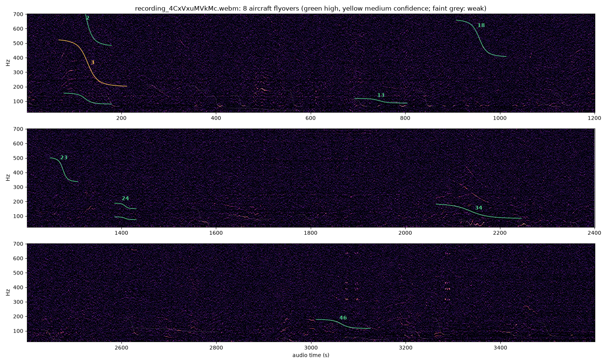
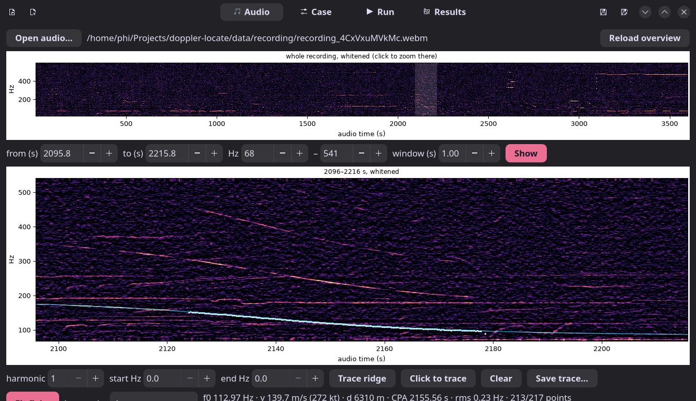
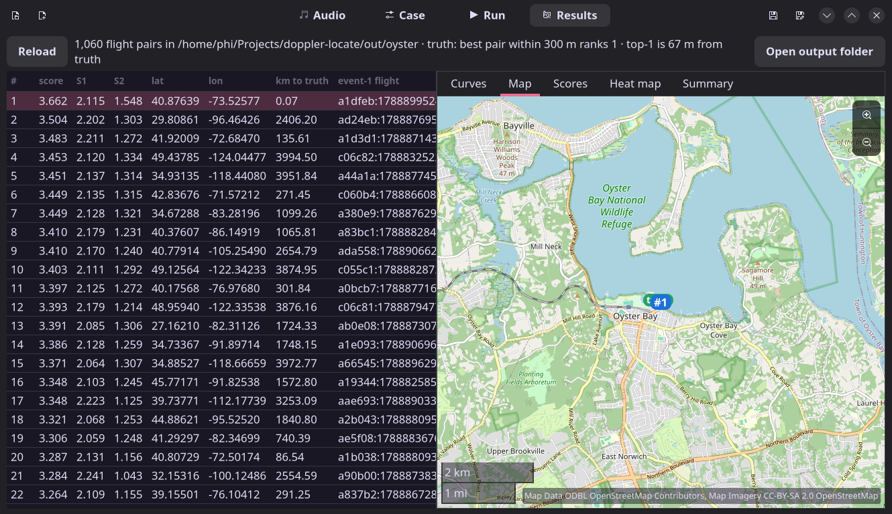

# doppler-locate

Find where an audio recording was made from the Doppler curves of propeller aircraft hidden in
its spectrogram, matched against public ADS-B flight tracks.

This is an independent re-implementation of the method shown in colsto's video
["I discovered a sound that leaks your exact location (and it's everywhere)"](https://www.youtube.com/watch?v=UytYrhYLOKI).
The video's author released no code; everything here was rebuilt from the narration and what is
shown on screen, using only free data (adsb.lol instead of Flightradar24).

It also contains a stand-alone **flyover detector** (`dopploc detect`) that tells whether any
recording or web video contains aircraft Doppler curves, and a GTK desktop app for the whole
workflow.

> **Responsible use.** The point of the video, and of this code, is that ambient sound can
> reveal a location. Use it on your own recordings, on public challenges such as the video's,
> or with the consent of whoever made the recording. Do not use it to locate people who have not
> chosen to share where they are.

## Results

The video's challenge recording (60 min, "filmed 9/8/26", somewhere in the continental US;
the answer shown in the video is Oyster Bay, NY), searched over the whole continental US with
no location prior:

| Run | Truth rank | Rank 1 distance from the camera | Score, 1st vs 2nd |
|---|---|---|---|
| Own measurements of both flyovers (`cases/oyster.toml`) | **1** of 1,060 flight pairs | 67 m | 3.662 vs 3.504 |
| The video's measured ranges (`cases/oyster_video.toml`) | **1** | 67 m | 3.683 vs 3.464 |
| Synthetic recording rendered from real tracks (`cases/synth.toml`) | **1** | 52 m | 4.378 vs 3.546 |
| Single faint flyover + known time (`cases/oyster_single.toml`) | not found | | see below |

The two flyovers are a Pilatus PC-12 at 17,250 ft (6.2 km slant range) and a King Air 350
descending through ~3,200 ft (3.5 km), heard 920 s apart. A 25 m heat map around rank 1
(`dopploc heatmap cases/oyster.toml --rank 1`) peaks 13 m from the camera. The GPU and CPU
searches give the same ranking.

What it took, beyond the video's description, to rank the truth first with free data:

- **Winds and temperature aloft** (NOAA GFS analysis). For the PC-12 at 5.5 km the curve's
  residual at the truth drops from 0.55 Hz (still air, c = 343 m/s) to 0.21 Hz. A wind fitted to
  the audio alone (14.4 m/s from 316°) agrees with GFS (15.1 m/s from 322°).
- **One clock shift fitted to both events**, rather than letting the far, flat event 1 set it.
- **Wide f0 and offset tolerances** (±8 %, ±8 s): straight-line fits are biased when the
  aircraft descends or slows (event 2: the fit gives 134.4 Hz, the true geometry needs 126 Hz).
- **Removing steady tones** (running median per frequency bin) before scoring; intermittent
  hums at 107, 160 and 241 Hz otherwise attract wrong candidates.

**Single-event mode could not be reproduced.** The faint curve at ~1279 s (≈20:38 UTC, ~0.7 km,
~72 m/s) has no matching aircraft in the adsb.lol data: the only non-jet within 8 km of the
camera between 20:30 and 20:46 UTC is an R-44 at 4 km. The video used Flightradar24, which has
more receivers and MLAT coverage. The code path (trace scoring, `[[event]] trace = ...`) is
implemented but not yet validated on a case where the aircraft is in the data.

The margin over the runner-up is narrower than in the video (3.66 vs 3.50 here; the video shows
20.5 vs 15.3 on its own scale, so the numbers are not directly comparable).

**Other engine types.** The physics works for any aircraft that emits a steady tone and is in the
ADS-B data; propeller aircraft are simply the best case (strong low-pitched blade-pass tones that
carry for kilometres, low and slow flight). Helicopters are kept in the search. Jets are left out
by default (`[search] exclude_engines = ["J", "R"]`, as in the video): their sound is mostly
broadband, their tones are high-pitched and absorbed over kilometres, and they usually fly high
and fast. With jets kept (`cases/oyster_jets.toml`) the truth still ranks 1st (67 m, 3.662 vs
3.504) and the best pair involving a jet ranks 8th, but there are 2.9× the flight pairs (3,078,
68 % with a jet) and 12.5× the candidates; the search takes 4× as long (305 s) and 2.8× the memory
(34 GB), and scoring ~6× as long (480 s).

## How it works

1. **Measure** each flyover on a zoomed, whitened spectrogram (propeller blade-pass tones sit
   around 50–600 Hz and are usually inaudible). Trace the ridge and fit a straight-line,
   constant-speed flyby: the speed sets the size of the frequency drop, the closest-approach
   (CPA) slant distance how fast it happens. Profile the fit to get generous speed and distance
   ranges.
2. **ADS-B**: one UTC day of every aircraft over the continental US. Known jet types are removed
   with the ICAO type table (unknown types are kept, as in the video).
3. **Candidates**: a 200 m Albers grid. For every flight pass near every cell: the 3D slant
   distance at CPA (aircraft altitude above MSL, cell height from a DEM) and the **delayed CPA
   time** (emission time + distance / c). Keep cells that hear an event-1 match and, the measured
   offset ± a tolerance later, an event-2 match.
4. **Silence**: drop candidates that would have heard another non-jet flight between the two
   events nearer than the farther of the two (the video's rule).
5. **Model and score**: for each surviving point (refined to 100 m), model the exact curve it
   would have heard from the real interpolated track, using the **emission-time** radial velocity
   (`t_receive = t_emit + R(t_emit)/c`), the GFS wind at the aircraft's altitude and the
   path-mean sound speed and wind. Score = mean whitened spectrogram brightness under the curve's
   harmonics, with one audio-clock shift shared by both events and f0 swept per event. A coarse
   pass covers every candidate, a fine pass the best ones.
6. **Single-event mode**: one faint curve plus a known time window; the traced line is compared
   with each candidate's modelled curve.

## Does a recording contain flyovers? (`dopploc detect`)

```
dopploc detect REC.webm
dopploc detect "https://www.youtube.com/watch?v=..." [--start 600 --duration 1800]
```

No flight data needed. Writes `report.md` (a table), `detections.png`, `detections.json` and
`events.toml` (ready-made `[[event]]` blocks for a case file) under `out/detect/<name>/`. Web
links are downloaded with yt-dlp into `data/downloads/` (the whole audio track, once; a section
is cut locally, and times are always on the video's clock).

On a log-frequency axis a straight-line flyby is one fixed curve shape per (speed, CPA distance /
speed) pair, and f0 is only a vertical shift. 108 such templates are slid over the whitened
spectrogram (steady hums removed) with FFT cross-correlation, normalised per frequency band.
Peaks are de-duplicated, grouped into harmonics, traced and fitted with the same flyby fit used
to measure events. Sources passing within 150 m or slower than 30 m/s (road vehicles, people)
are listed separately. A detection is high or medium confidence only when the fit follows the
traced ridge to within 1 % of its frequency. A 60-minute recording takes about 70 s on 32 cores.



### Known-answer tests

`scripts/eval_detect.py` compares detections with the passes ADS-B says a recording must
contain at a known place and time. A detection counts only if its time, speed and distance are
all consistent with the aircraft's, and the script reports how many matches chance alone would
give:

```
python scripts/eval_detect.py out/detect/NAME/detections.json --lat LAT --lon LON --audio0 UNIX_UTC
python scripts/eval_detect.py out/detect/oyster/detections.json --case cases/oyster.toml --truth out/oyster/truth.json
```

- **The video's recording (60 min)**, against ADS-B passes at the solved camera position and
  clock: 8 high/medium detections.
  - Both events the video used: E1 at 35:55 (113.2 Hz, 137 m/s, 6.0 km; ADS-B: PC-12 at 6.2 km,
    137 m/s) and E2 at 51:08 (King Air 350, 3.5 km).
  - The video's faint single-event curve at 21:18 (402 Hz, 70 m/s, 0.7 km), not in adsb.lol.
  - Two jets (A350 at 5.5 km, A321neo at 3.2 km).
  - Three more clear flyby curves with no ADS-B aircraft (2:09, 12:29, 23:29).

  4 of the 8 match an ADS-B pass in time, speed and distance (0.6 expected by chance). Missed:
  pistons at 4–10 km, turboprops beyond 7 km and almost all jets (their sound is mostly
  broadband). 16 close-range sources were set aside. The confidence rule was tuned on this
  recording, so these numbers are optimistic.
- **Synthetic recording (13 min)**: both passes within 1 km found with harmonics 1–4 (CPA time
  within 0.6 s, f0 within 1.4 %, speed within 6 %, distance 12–29 % long); the pass at 3.6 km
  was missed; no false high/medium detections.
- **HWNDU flag stream (2017, Greeneville, TN)**: only short clips survive (4:39 from 8 March,
  2:58 from 10 March, 3:58 from August); none contains an aircraft Doppler curve. A full
  geolocation test is impossible with free data, because adsb.lol history starts in 2023.
- **Lorain lighthouse webcam (Ohio, 15 June 2026, 2.6 h)**: a fixed camera at a known position,
  with the clock from the stream's start time. 4 high/medium detections. One matches ADS-B: a TBM
  900 turboprop detected at 199 m/s and 8.2 km, against 193 m/s and 7.8 km in ADS-B (0.1 matches
  expected by chance). The other three are close (190–640 m), slow sources with no ADS-B aircraft
  (boats are plausible at a harbour). A CRJ-900 jet at 2.5 km matches at low confidence. Three
  pistons at 3–9 km are missed; the nearest (a Cessna 182 at 3.4 km) is visible, but its tone
  fades just after closest approach, which leaves speed and distance undetermined.
- **Moosehead Lake seaplane fly-in webcam (Maine, 12 September 2026, 4.8 h)**: 30 high/medium
  curves, mostly slow (30–60 m/s) and close (0.2–1 km), as expected at a fly-in. None can be
  checked: adsb.lol has a single point below 3,000 ft within 5 km of the seaplane base in those
  4.8 hours (no receivers nearby, and many seaplanes carry no ADS-B transmitter).

Many webcam archives make poor tests: of 31 archived streams checked, the Ocean City boardwalk
cams and several others carry a silent audio track (an Opus bitrate of 3.6 kbit/s gives it away),
and rural areas have little low-altitude ADS-B coverage.

## Install

Linux, Python ≥ 3.11 (developed on 3.13), `ffmpeg`. The GitHub CLI (`gh`, logged in) downloads
the ADS-B history; `yt-dlp` is needed for web links. An NVIDIA GPU with the CUDA toolkit is
optional.

```
uv venv --python 3.13 .venv
uv pip install -e '.[test,gui]'
make -C native            # CUDA + OpenMP library (needs nvcc); `make -C native cpu` for OpenMP only
```

Without the native library everything falls back to numba (slower). The desktop app also needs
the system GTK 4, libadwaita (≥ 1.7) and libshumate typelibs.

## Reproducing the video's result

```
yt-dlp -f 'bestaudio[ext=webm]' -o data/recording/recording_4CxVxuMVkMc.webm https://youtu.be/4CxVxuMVkMc
dopploc fetch-types                        # ICAO type table -> data/ref/
dopploc fetch-adsb 2026-09-08              # ~3.9 GB split tar -> data/adsb/raw/2026-09-08
dopploc ingest 2026-09-08                  # -> data/adsb/2026-09-08/points-*.parquet (~1.2 GB)
scripts/run-capped.sh 26G dopploc search cases/oyster.toml   # -> out/oyster/candidates.parquet
scripts/run-capped.sh 26G dopploc score cases/oyster.toml    # -> out/oyster/scored.parquet, report
dopploc heatmap cases/oyster.toml --rank 1
```

The first search builds a 200 m elevation lattice of the continental US from the Copernicus DEM
(~7 min, 1 GB, cached). `scripts/run-capped.sh` runs a step in a memory-capped systemd scope so
that an overrun kills only that job; without systemd, run the `dopploc` command directly. To see
distances to the true position, put `{"lat": ..., "lon": ...}` in `out/oyster/truth.json` and
pass `--truth out/oyster/truth.json` to `score`.

## Measuring a recording of your own

```
dopploc detect REC.webm                                        # find candidate flyovers
dopploc spec REC.webm --t0 2050 --t1 2260 --fmin 40 --fmax 600 --out e1.png
dopploc trace REC.webm --t0 2085 --t1 2245 --fmin 70 --fmax 200 --f-start 177 --out e1.csv --png e1_trace.png
dopploc fit e1.csv --name E1 --harmonics 1 2 3                 # prints an [[event]] block
```

Put two events into a case file (copy `cases/oyster.toml`; `src/dopploc/config.py` documents
every option), fetch and ingest the recording's UTC day, then `dopploc run CASE.toml`. The ADS-B
ingest, search grid and elevation lattice cover the continental US by default. Other regions
need `dopploc ingest --bbox` plus `[search] bbox` and `elevation_lattice = false`; that path is
untested.

`dopploc synth cases/synth_base.toml --out out/synth --seed 3` renders a synthetic recording from
real tracks, for validation.

## Desktop app

```
dopploc-gui cases/oyster.toml
scripts/install-desktop.sh      # "Doppler Locate" in the app launcher (per user; --uninstall removes it)
```

Started without a case (e.g. from the launcher), it reopens the last case used.




- **Audio**: open a file or a web video link and get a whole-recording overview. **Detect
  flyovers** lists every aircraft Doppler curve (click one to zoom to it with its fitted model).
  Trace a ridge automatically (Viterbi) or by clicking, fit a flyby, adjust the model with
  sliders (f0, speed, CPA distance, CPA time) over the spectrogram, and add it to the case as an
  event.
- **Case**: every setting of the case file. The TOML is edited in place (comments are kept; a
  `.bak` copy is made the first time a hand-written file is saved).
- **Run**: fetch and ingest ADS-B, search, score and heat maps as child processes with a live
  log. Heavy steps run through `scripts/run-capped.sh`.
- **Results**: ranked flight pairs (with the distance to `truth.json` when present), the modelled
  curves over both events' spectrograms, an OpenStreetMap view of the top candidates, the
  event-score scatter, heat maps and the summary.

## Data sources (all free)

| What | Source |
|---|---|
| ADS-B tracks | [adsb.lol globe history](https://github.com/adsblol) daily readsb dumps (ODbL), via `gh release download` |
| Aircraft type → engine class | [tar1090-db](https://github.com/wiedehopf/tar1090-db) `icao_aircraft_types2.js` (ICAO Doc 8643 codes such as `L1P`) |
| Terrain | Copernicus GLO-90 / GLO-30 DEM, AWS open data |
| Geoid | EGM96 grid from cdn.proj.org (GNSS altitude → MSL) |
| Winds / temperature aloft | NOAA GFS 0.25° analyses, AWS open data (byte-range requests for the needed fields only) |
| Surface wind (optional) | Iowa Environmental Mesonet ASOS archive |
| Map tiles (desktop app only) | OpenStreetMap standard tiles via libshumate |

The video used Flightradar24 (`pyfr24`, a paid API) and a 30 m DEM. The pipeline sends nothing
about a search area anywhere; the desktop app's map view requests OpenStreetMap tiles for the
area on screen.

## Performance

RTX 4090, 32-thread CPU, 62 GB RAM:

| Step | Time |
|---|---|
| Ingest one day (53 M points) | ~40 s |
| Continental-US search, CPU (numba, 24 processes; `[search] gpu = false`) | ~126 s, peak ~20 GB |
| Continental-US search, GPU (default when the CUDA library is built) | ~80 s, peak 12 GB |
| Scoring 85 k candidates (CUDA forward model + sweeps) | 40–120 s (numba: ~350 s) |
| Flyover detection, 60 min of audio | ~70 s |

## Code layout

| Path | Role |
|---|---|
| `src/dopploc/adsb.py` | adsb.lol fetch, readsb trace parsing, parquet ingest, type table |
| `audio.py` | ffmpeg decode, STFT, whitening |
| `measure.py` | Viterbi ridge tracing, straight-line flyby fit, profile ranges |
| `physics.py` | Doppler with wind and sound-speed profile, emission-time solver, CPA (numba) |
| `atmos.py`, `wind.py` | GFS winds and temperature aloft, ASOS surface wind |
| `tracks.py` | track segmentation, altitude datum, Hermite resampling in ECEF |
| `dem.py`, `geo.py` | DEM tile cache, elevation lattice, ECEF / Albers grid / geoid |
| `search.py`, `search_gpu.py` | CPA records, event matching, offset and silence filters (CPU / CUDA) |
| `score.py`, `native.py` | forward model on real tracks, two-event and trace scoring, coarse-to-fine |
| `report.py` | ranked tables, GeoJSON, scatter and curve-overlay plots |
| `synth.py` | synthetic recordings rendered from real tracks |
| `detect.py` | flyover detector (matched filter over flyby shapes), yt-dlp input |
| `expect.py` | flyovers a recording should contain at a known place and clock (ADS-B ground truth) |
| `gui/` | GTK 4 / libadwaita desktop app |
| `native/` | CUDA / OpenMP kernels (forward model, scoring sweeps, search) |
| `scripts/` | known-answer evaluation, memory-capped runner, launcher install |
| `cases/` | case files for the video's recording and the synthetic test |

Development notes and the results log are in [NOTES.md](NOTES.md).

## Contributing

Enable the repository's hooks once per clone:

```
git config core.hooksPath .githooks
```

They refuse commits and pushes that would put personal data into history: author e-mails that
are not GitHub noreply addresses, e-mail addresses, home-directory paths, credentials, precise
coordinate pairs, data or media files, and the same in the text of screenshots (read with
tesseract). Private strings to block (a name, a street, a host name) go one per line in
`.git/info/pii-denylist`, which is never committed. `python3 .githooks/pii_check.py tree`
audits a whole revision.

## Licence

Code: [MIT](LICENSE). Data downloaded at run time keeps its own licence (adsb.lol: ODbL;
OpenStreetMap: ODbL; Copernicus DEM: Copernicus licence). The challenge recording and the video
belong to their author and are not included.
